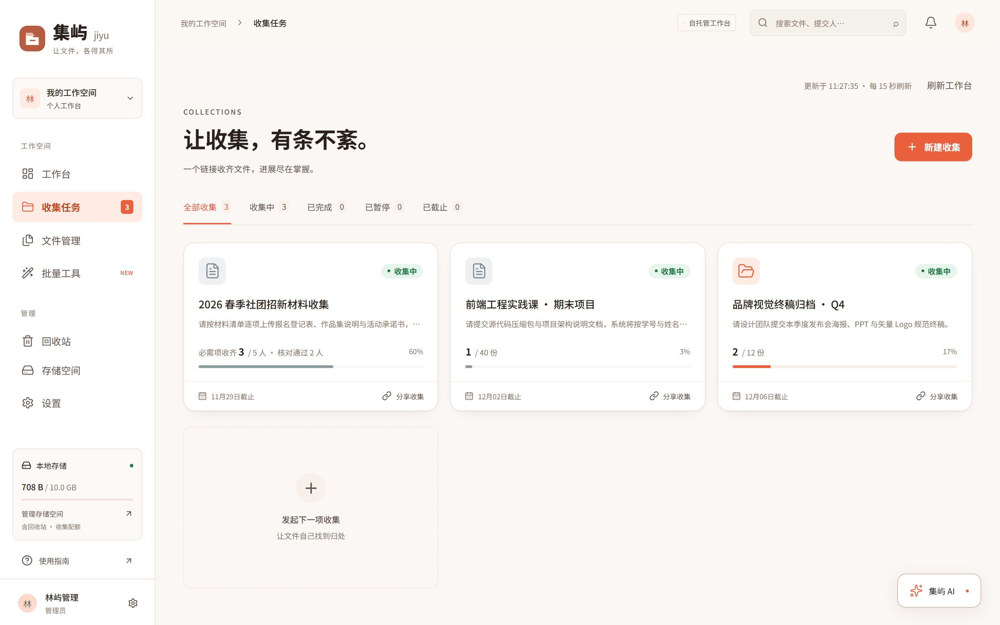
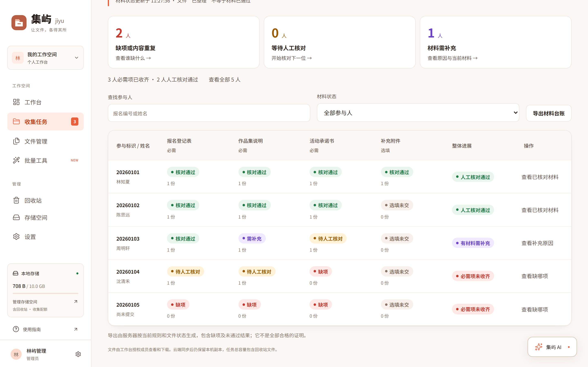
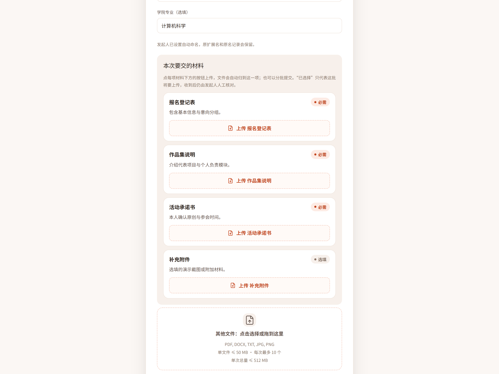

# Jiyu (集屿)

[简体中文](README.md) | English

[](https://github.com/1Beyond1/jiyu/actions/workflows/ci.yml)
[](LICENSE)

A home for every collected file. **Jiyu** is a self-hosted file collection, checklist review, and organization workbench designed to run on a personal VPS.

Author & Maintainer: [1Beyond1](https://github.com/1Beyond1) · [Repository](https://github.com/1Beyond1/jiyu) · [Changelog](CHANGELOG.md)

**Current Version: v0.4.0** (SQLite schema 5) — Collect files from anyone through a single random link with no submitter login required, and organize everything in one workbench with checklist verification, paginated search, batch renaming, streaming ZIP archives, online backups, and optional cloud sync. Back up your full data directory before upgrading from `v0.3.x` (schema 5 databases cannot be opened directly by v0.3).

## Interface Preview

### Collections Overview

Manage active, completed, and closed file collection tasks in one workspace with live required-item progress, review counts, deadlines, and local storage quota visibility.



### Per-Participant Material Review Matrix

Track required and optional materials across every participant, distinguish received items from manual approvals, filter missing or follow-up entries, and export CSV ledgers.



### No-Login Public Submission Page

Submitters open a random share link to fill custom fields and upload files directly into dedicated required/optional material slots—no account required, with automatic naming and extension preservation.



## Key Features

### 1. Structured Collection & Material Review Workbench

- **Guided Creation & Reusable Templates**: Built-in templates for assignments, registration packages, and project deliverables; save, reuse, archive, and restore custom templates from existing collections (sensitive rosters, deadlines, tokens, and storage bindings are never copied).
- **Custom Fields & Automatic Naming**: Define up to 8 custom text fields, identify submitters by name or a required field, and compose auto-naming rules (name, collection, date, sequence, original filename, and field values) with live preview while preserving original extensions and preventing per-collection collisions.
- **Per-Participant Material Checklist**: Define up to 8 required/optional material slots per collection; assign files explicitly and track _required items received_ separately from _manually approved_ (duplicate file content cannot satisfy two required slots). Reviews bind to rule and file versions with atomic conflict rejection and automatic staleness invalidation when rules or files change. Desktop matrix view + mobile participant cards.
- **Roster Ledger & Private Receipts**: Compare submissions against an expected submitter roster (visible only inside the workbench) and export CSV ledgers. Submitters can inspect status, import legacy text receipts, supplement, or replace their own batch using a private receipt key (superseded batches move to trash; concurrent replacements succeed only once). Public pages clearly distinguish active file counts from cumulative historical submissions.

### 2. Resumable Uploads, Search & Efficient Sync

- **Reliable Chunked Uploads**: 4 MiB chunks, per-chunk and whole-batch SHA-256 verification, pause/resume, 24-hour continuation, and idempotent receipts. Includes pure-JS SHA-256 and UUID fallbacks so LAN non-HTTPS origins do not crash when WebCrypto is unavailable.
- **Server-Side Pagination & `ETag` Incremental Sync**: Dedicated `GET /api/files` and `GET /api/collections/:id/files` endpoints supporting collection, status, kind, trash, search (`q`), sort, and page parameters. Both `GET /api/workspace` and file pagination endpoints emit strong-consistency `ETag` headers with `Cache-Control: no-cache` and return `304 Not Modified` on `If-None-Match`, minimizing serialization and frontend re-renders during 15-second polling.
- **Previews, Full-Text OCR & Streaming ZIP Archives**: Built-in image/PDF previews and text indexing for TXT, DOCX, PDF, and images (runtime Docker image ships with Poppler and Tesseract for Simplified Chinese & English OCR). Preview archive paths and stream ZIP downloads directly to the browser (flat, by collection, by submitter, or collection/submitter; up to 500 files / 10 GiB per archive).

### 3. Cloud Storage Sync, Backups & Access Control

- **Multi-Provider Sync with Native Checksum Verification**: Supports WebDAV, S3/S3-compatible buckets, Baidu Netdisk, OneDrive, and Google Drive via official OAuth flows. Every file is stored safely on local disk first. To save bandwidth, S3 uploads send `x-amz-checksum-sha256` and accept matching response checksums or single-part MD5 `ETag`s; OneDrive verifies `file.hashes.sha256Hash` / `quickXorHash`; Google Drive verifies `sha256Checksum`. When checksums are absent, mismatched, or `JIYU_STORAGE_STRICT_READBACK=1` is set, Jiyu rejects corrupted uploads or falls back to full read-back verification.
- **Exponential Backoff Auto-Retry**: Transient network/upstream errors (HTTP 429/5xx, timeouts, connection drops) automatically retry with capped exponential backoff (default 3 retries, tracking `retryCount` and `nextRetryAt`), while auth/config/checksum errors fail immediately without blind retries. Manual batch retry remains available.
- **Role-Based Permissions & Sanitized Exports**: Admin, Editor, and Viewer roles enforced on every API request and explicitly in UI components (`canEdit`). Stored credentials are encrypted at rest with a server master key; non-admin storage views redact endpoints, OAuth callback URLs, and error paths. Metadata JSON exports strip `uploadToken` and `expectedSubmitters` by default, requiring explicit confirmation for full sensitive exports.
- **Online Snapshots & Deployment Diagnostics**: Full online SQLite + object backups with scheduled retention and restore verification to a clean directory, plus a built-in diagnostics panel checking disk space, quotas, DB health, HTTPS, backup storage, and PDF/OCR binaries.

### 4. Optional AI Assistance (Disabled by Default)

- Works with Responses and Chat Completions compatible APIs, configurable by admins or pre-provisioned by operators via `JIYU_AI_*` environment variables. Enforces public HTTPS (port 443), blocks private/loopback hosts and redirects, and keeps API keys server-side.
- Offers floating assistant rename/tag proposals, one-sentence collection drafting with human clarification, and citation-verified material pre-review (exact UTF-16 excerpt matching against the active file snapshot). Every external send requires explicit scope approval, excerpts require separate consent, and all proposals require manual review before applying.

## Local Quick Start & Development

Requires **Node.js 24.11+ (24.x)** with `npm` and the single `package-lock.json` lockfile:

```sh
npm ci
npm run check
npm test
npm run build
npm start
```

Open [http://127.0.0.1:3000](http://127.0.0.1:3000). On first launch, read the setup token from `data/setup-token` to create the primary administrator account (minimum 12-character password; no default password). Local runtime data is stored in the git-ignored `data/` directory.

Common scripts:

```sh
npm run server:dev    # Start Fastify backend with --watch on port 3000
npm run dev           # Start Vite frontend dev server on port 5173 (proxies /api to 3000)
npm run check         # TypeScript check across frontend and backend (tsc -b)
npm run format        # Format codebase with Biome
npm run format:check  # Verify Biome formatting (enforced in CI)
npm run lint          # Run Biome static analysis
npm test              # Run unit and real HTTP integration test suites
npm run build         # Type-check and build production frontend bundle (dist/)
npm run data          # Offline data inspection and backup restore CLI
```

When running frontend and backend separately in development, set `JIYU_ORIGIN=http://127.0.0.1:5173` on the backend. In production, `npm start` serves both the built frontend and API from a single Fastify process.

## VPS Deployment & Environment Variables

Deploy with Docker Compose + Caddy for automatic HTTPS:

```sh
cp .env.example .env
# Edit .env with your domain, external HTTPS origin, quotas, and optional AI/rate-limit settings
docker compose up -d --build
docker compose exec app cat /data/live/setup-token
```

Key environment variables (see [.env.example](.env.example) and [Deployment Guide](docs/DEPLOYMENT.md) for details):

| Variable                                             | Default                 | Description                                                                                 |
| ---------------------------------------------------- | ----------------------- | ------------------------------------------------------------------------------------------- |
| `JIYU_DOMAIN`                                        | —                       | Domain bound by Caddy (must resolve to your VPS)                                            |
| `JIYU_ORIGIN`                                        | `http://127.0.0.1:3000` | Exact external browser origin (scheme + host + optional port)                               |
| `JIYU_HOST` / `JIYU_PORT`                            | `127.0.0.1` / `3000`    | Server bind address and port (`0.0.0.0:3000` inside container)                              |
| `JIYU_DATA_DIR` / `JIYU_BACKUP_DIR`                  | `./data` / `./backups`  | Persistent data and online backup directories                                               |
| `JIYU_QUOTA_MB` / `JIYU_REQUEST_MB`                  | `10240` / `512`         | Workspace total storage quota and per-request limit (MiB)                                   |
| `JIYU_BACKUP_MAX_KEEP`                               | `30`                    | Maximum retained scheduled online backups (`1–30`)                                          |
| `JIYU_STORAGE_STRICT_READBACK`                       | unset                   | Set to `1` to force full remote read-back verification instead of native checksum fast-path |
| `JIYU_AI_BASE_URL` / `JIYU_AI_MODEL` / `JIYU_AI_KEY` | empty                   | Operator-managed AI endpoint, model ID, and API key (all three required)                    |
| `JIYU_AI_PROTOCOL` / `JIYU_AI_DAILY_CALLS`           | `chat` / `50`           | Managed AI protocol (`chat`/`responses`) and daily call cap                                 |
| `JIYU_RATE_LIMIT_GLOBAL`                             | `180`                   | Global requests per minute limit                                                            |
| `JIYU_RATE_LIMIT_UPLOAD_MULTIPART`                   | `30`                    | Multipart upload requests per hour limit                                                    |
| `JIYU_RATE_LIMIT_UPLOAD_CREATE`                      | `60`                    | Chunked upload session creations per hour limit                                             |
| `JIYU_RATE_LIMIT_UPLOAD_CHUNK`                       | `180`                   | Chunk PUT requests per minute limit                                                         |

> Warning: Never run `docker compose down -v` unless you intend to delete persistent volumes. Metadata JSON exports do not include file contents and cannot replace full backups.

## Architecture & Repository Layout

Single repository, single React frontend, single Fastify + built-in Node SQLite service sharing TypeScript types and pure domain rules:

```text
src/       React frontend (components/, features/, lib/ shared rules & API client, types.ts)
server/    Fastify API, auth, SQLite store (schema 5), chunked uploads, archives, cloud sync, AI, CLI & tests
public/    Static assets
docs/      Project plan, architecture decisions, design spec, and deployment runbooks (Chinese)
scripts/   Helper scripts
```

- [Changelog](CHANGELOG.md) · [Deployment Guide](docs/DEPLOYMENT.md) · [Architecture](docs/ARCHITECTURE.md) · [Project Notes](docs/PROJECT.md) · [Contributor Guidelines](AGENTS.md)

## Known Boundaries

- Cloud storage adapters (WebDAV, S3, Baidu Netdisk, OneDrive, Google Drive) and AI flows are covered by automated protocol, checksum, retry, and security tests; live end-to-end validation with real cloud accounts and external LLM providers (including semantic quality, billing, and latency) must be verified with your own credentials.
- Cloud sync retains complete local copies on the VPS (required for previews, streaming archives, and full backups) and does not reclaim local disk space automatically.
- Jiyu does not include antivirus scanning or end-to-end encryption. Configure HTTPS, domain routing, access controls, and off-site backup replication before production use.

## License

Jiyu is licensed under the [MIT License](LICENSE), Copyright (c) 2026 1Beyond1. Third-party dependencies remain under their respective licenses.
