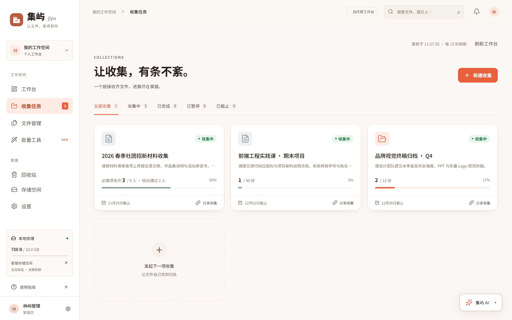
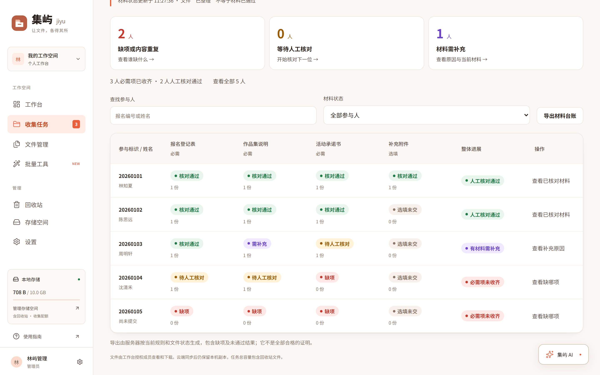
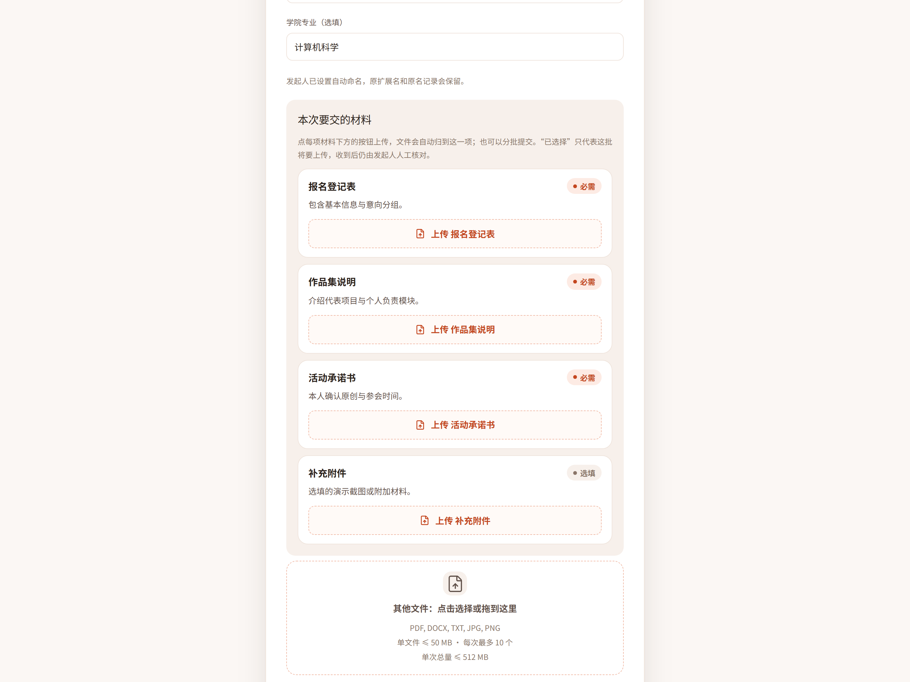

# 集屿 Jiyu

简体中文 | [English](README.en.md)

[](https://github.com/1Beyond1/jiyu/actions/workflows/ci.yml)
[](LICENSE)

让每一份文件都有归处。部署在个人 VPS 的自托管文件收集、材料核对与整理工作台。

作者与维护者：[1Beyond1](https://github.com/1Beyond1) · [公开仓库](https://github.com/1Beyond1/jiyu) · [更新记录](CHANGELOG.md)

**当前版本 v0.4.0**（SQLite schema 5）：用一个随机链接集中收集文件，提交者无需登录即可断点续传，工作台成员可在同一处完成材料收齐核对、分页检索、批量命名、流式 ZIP 打包、在线备份与可选云端同步。从 `v0.3.x` 升级前请先生成完整备份（schema 5 数据目录不能直接用 v0.3 打开）。

## 界面预览

### 收集任务总览

集中管理进行中、已完成与已截止的收集任务，实时查看必需项收齐进度、人工核对人数、截止时间与本地存储配额。



### 按人材料核对矩阵

按参与人与材料清单逐项对照收齐状态与人工核对结论，快速筛选缺项或待补交人员并导出 CSV 材料台账。



### 免登录分材料提交页

提交者打开随机分享链接即可填写自定义字段并按材料槽位逐项上传，无需注册登录，自动保留原名与扩展名规则。



## 核心能力

### 1. 灵活收集与材料核对工作台

- **分步创建与收集模板**：内置作业、报名材料、项目交付等模板，支持从现有任务保存、复用、归档与恢复模板（不复制名单、截止时间、令牌或存储连接）。
- **收件分发与访问保护**：分享弹窗内置纯本地零依赖 SVG 二维码（天然兼容 CSP）、一键下载分享图与复制结构化群通知；支持为任务设置可选 **4–8 位访问提取码**（scrypt 哈希存于任务 JSON，不升 SQLite schema 6，解锁接口独立防爆破限流，解锁前不泄露任务详情与材料清单）与 **「仅允许应交名单内标识提交」** 防枚举准入开关。
- **自定义字段与自动命名**：最多 8 个自定义文本字段，按姓名或必填字段识别提交人；支持按姓名、任务、材料项（`{材料项}`）、日期、累计序号、原名及字段组合自动命名与批量重命名并实时试算，保留原扩展名并按任务防重名。
- **分栏连续审阅与一键催交**：支持定义最多 8 项必需/选填材料；管理端审阅参与人时提供**左右分栏连续审阅**（左侧内联预览图片 / PDF / 2 MiB 内 UTF-8 文本与防 XXE 的 DOCX 即时轻量预览，右侧归属与核对表单，窄屏自动上下折叠），支持「保存并跳转下一位待核对」连续流转；在材料工作台与提交人台账内置**零外发一键催交话术**（群公告汇总含脱敏开关 + 单人私聊自动带精确缺项、`materialReview.note` 退回说明与回执替换指引）。
- **提交人台账与私密回执**：内置应交名单对照与 CSV 台账导出（名单仅工作台可见）；提交者凭私密回执可查询进度、导入旧版文本回执、补交或替换对应批次（旧批次移入回收站，并发替换仅成功一次）。公开提交页清晰区分当前有效份数与历史累计提交数。

### 2. 断点续传、检索、定向归档与交互体验

- **可靠分片上传**：4 MiB 分片、SHA-256 逐片与整批校验、暂停恢复、24 小时断点续传及幂等回执确认；兼容非 HTTPS 局域网环境的纯 JS SHA-256 / UUID 回退。
- **分页筛选、6 种排序与 `ETag` 增量同步**：提供 `GET /api/files` 与 `GET /api/collections/:id/files` 分页筛选接口，前端打通 6 种排序（时间/名称/大小正倒序）与 `已整理` 状态筛选；按请求 `endpoint` 独立维护强一致 `ETag` / `If-None-Match` → `304 Not Modified` 缓存，消除后端分页下重复正文检索请求。
- **正文预览、OCR 与按材料项定向打包**：支持图片/PDF 在线预览与小体积 UTF-8 文本/DOCX 即时轻量预览，TXT/DOCX/PDF/图片正文提取与中文全文检索（运行镜像内置 Poppler 与 Tesseract 简体中文/英文 OCR）；流式 ZIP 打包支持 6 种目录结构（新增 `按材料项 / 提交人` 与 `按提交人 / 材料项`）及严格绑定 `rulesRevision` 的「仅打包人工核对通过（`accepted`）」筛选（单次上限 500 文件 / 10 GiB）。
- **回收站分页清理与三态深浅主题**：回收站接入后端分页与搜索，新增仅管理员可见的二次确认在线永久清理（自动校验活跃 ZIP 打包与在线备份引用，防并发误删）；内置「跟随系统 / 暖白日间 / 暖炭深色」三态主题切换并本地持久化。

### 3. 云端同步、备份与安全权限

- **多云端适配与省流校验**：支持 WebDAV、S3/兼容存储，以及百度网盘、OneDrive、Google Drive 官方授权协议；所有文件先在本机可靠接收并保留完整副本。S3 优先核验 `x-amz-checksum-sha256` 或单段 MD5 `ETag`，OneDrive 优先核验 `sha256Hash` / `quickXorHash`，Google Drive 优先核验 `sha256Checksum`，校验一致时跳过二次全量下载；缺失或开启 `JIYU_STORAGE_STRICT_READBACK=1` 时自动回退全量读回验证。
- **指数退避自动重试**：云同步队列对瞬态网络/上游错误（HTTP 429/5xx、连接超时或中断）按指数退避自动重试（默认最多 3 次，状态记录 `retryCount` 与 `nextRetryAt`），对 401/403/配置与校验错误不盲目重试，保留失败项手动批量重试。
- **权限隔离与数据保护**：管理员 / 编辑者 / 只读成员三级角色，服务端逐请求鉴权 + 前端显式 `canEdit` 组件权限控制；凭证采用服务端主密钥加密存储，非管理员视图自动脱敏云存储配置与错误路径；元数据清单导出默认脱敏 `uploadToken` 与 `expectedSubmitters`，完整导出需二次确认。
- **在线完整备份与部署检查**：支持在线完整快照、定时计划与保留策略（可校验恢复至全新目录）；内置部署检查面板核对文件读写、数据库、磁盘配额、HTTPS、备份目录及 PDF/OCR 工具状态。

### 4. 可选 AI 辅助（默认关闭）

- 支持 Responses / Chat Completions 兼容接口，可由管理员在设置页配置或运维通过 `JIYU_AI_*` 环境变量预置；限定公网 HTTPS（443），禁止内网地址与重定向，凭证加密保存在服务端且不回显。
- 支持悬浮助手批量命名/标签建议、新建收集一句话材料草稿、以及带精确 UTF-16 原文出处的材料 AI 预核对。每次外发均须确认授权范围，正文摘录单独授权，所有建议先预览再由人工确认保存，支持撤销与每日调用次数上限控制。

## 本机启动与开发

需要 **Node.js 24.11+（24.x）**，使用 `npm` 与唯一锁文件 `package-lock.json`：

```sh
npm ci
npm run check
npm test
npm run build
npm start
```

打开 [http://127.0.0.1:3000](http://127.0.0.1:3000)。首次启动读取 `data/setup-token` 中的初始化口令，在页面创建管理员账号（密码至少 12 位，无默认密码）。正式数据默认存放在被 Git 忽略的 `data/` 目录。

常用开发与检查脚本：

```sh
npm run server:dev    # 启动后端开发服务（默认监听 3000，保存自动重启）
npm run dev           # 启动前端 Vite 开发服务（监听 5173，/api 代理到 3000）
npm run check         # 前后端 TypeScript 类型检查（tsc -b）
npm run format        # 使用 Biome 统一格式化代码
npm run format:check  # Biome 格式检查（CI 门禁）
npm run lint          # Biome 静态检查（0 Error CI 门禁）
npm test              # 运行全套前后端单元测试与真实 HTTP 集成测试
npm run build         # 类型检查并构建生产前端 dist/
npm run data          # 离线数据与备份恢复 CLI
```

前后端分离开发时，请将服务端环境变量 `JIYU_ORIGIN` 设为实际前端地址（如 `http://127.0.0.1:5173`）。生产运行只需 `npm start`，由同一个 Fastify 服务同时提供前端静态资源与 API。

## VPS 部署与环境变量

推荐使用 Docker Compose + Caddy 部署自动 HTTPS：

```sh
cp .env.example .env
# 编辑 .env，设置域名、外部 HTTPS Origin、配额等参数
docker compose up -d --build
docker compose exec app cat /data/live/setup-token
```

主要环境变量（完整示例见 [.env.example](.env.example) 与 [部署指南](docs/DEPLOYMENT.md)）：

| 变量名                                               | 默认值                  | 说明                                                |
| ---------------------------------------------------- | ----------------------- | --------------------------------------------------- |
| `JIYU_DOMAIN`                                        | —                       | Caddy 绑定域名（需已解析至服务器）                  |
| `JIYU_ORIGIN`                                        | `http://127.0.0.1:3000` | 外部完整访问 Origin，须与浏览器地址栏一致           |
| `JIYU_HOST` / `JIYU_PORT`                            | `127.0.0.1` / `3000`    | 服务监听地址与端口（容器默认 `0.0.0.0:3000`）       |
| `JIYU_DATA_DIR` / `JIYU_BACKUP_DIR`                  | `./data` / `./backups`  | 数据目录与在线备份目录                              |
| `JIYU_QUOTA_MB` / `JIYU_REQUEST_MB`                  | `10240` / `512`         | 工作台总存储配额与单次请求上限（MiB）               |
| `JIYU_BACKUP_MAX_KEEP`                               | `30`                    | 在线自动备份最大保留份数（1–30）                    |
| `JIYU_STORAGE_STRICT_READBACK`                       | 未开启                  | 设为 `1` 时禁用原生校验和省流，强制云端全量读回验证 |
| `JIYU_AI_BASE_URL` / `JIYU_AI_MODEL` / `JIYU_AI_KEY` | 空                      | 预置模型服务地址、模型 ID 与 Key（三项齐全生效）    |
| `JIYU_AI_PROTOCOL` / `JIYU_AI_DAILY_CALLS`           | `chat` / `50`           | 预置模型协议（`chat`/`responses`）与每日调用上限    |
| `JIYU_RATE_LIMIT_GLOBAL`                             | `180`                   | 全局每分钟限流次数                                  |
| `JIYU_RATE_LIMIT_UPLOAD_MULTIPART`                   | `30`                    | multipart 上传每小时限流次数                        |
| `JIYU_RATE_LIMIT_UPLOAD_CREATE`                      | `60`                    | 分片批次创建每小时限流次数                          |
| `JIYU_RATE_LIMIT_UPLOAD_CHUNK`                       | `180`                   | 分片上传每分钟限流次数                              |
| `JIYU_RATE_LIMIT_UNLOCK`                             | `6`                     | 公开提取码解锁每分钟防爆破限流次数                  |

> 注意：切勿使用 `docker compose down -v` 删除数据卷；元数据导出不包含文件正文，不能替代完整备份。

## 项目架构与目录

单仓、单前端应用、单 Fastify + Node 内置 SQLite 服务，前后端共享 TypeScript 类型与规则函数：

```text
src/       前端 React 应用（components/ 通用组件、features/ 业务页面、lib/ 共享规则与 API、types.ts）
server/    Fastify API、认证、SQLite 持久化（schema 5）、分片上传、归档、云同步、AI 编排、CLI 与测试
public/    静态资源
docs/      项目计划、技术架构、界面设计与部署运维文档
scripts/   辅助脚本
```

- [更新记录](CHANGELOG.md) · [部署指南](docs/DEPLOYMENT.md) · [技术架构](docs/ARCHITECTURE.md) · [项目计划](docs/PROJECT.md) · [开发约定](AGENTS.md)

## 部署说明

- 云端同步后仍保留本机完整副本（用于在线预览、归档打包与完整备份），不会释放 VPS 磁盘空间。
- 生产部署请自行配置域名、HTTPS、访问控制与异地备份（项目不含内置病毒扫描或端到端加密）。

## 开源协议

集屿采用 [MIT License](LICENSE)，Copyright (c) 2026 1Beyond1。第三方依赖遵循各自的开源许可证。
